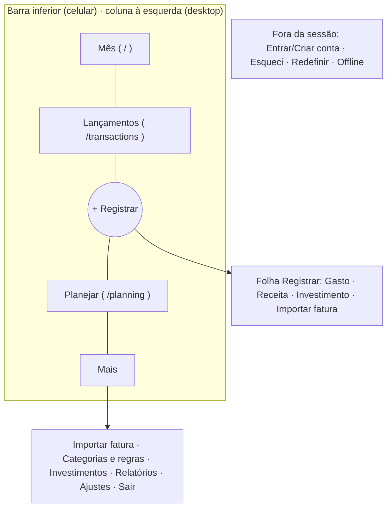

# Product brief — Finanças Pessoais (redesign + PWA)

Status: **rascunho da Fase 1** — aguardando correções do usuário. Itens marcados _(hipótese)_ não foram confirmados.

## Produto e público

App de finanças pessoais, multiusuário no código, mas de uso **pessoal**: uma pessoa registra e confere o próprio dinheiro. Cada dado pertence a um `userId`.

## Problema e proposta de valor

Saber, sem esforço, "como está meu mês" e manter o registro em dia. O diferencial já construído é a **importação de fatura de cartão por PDF** (lida no navegador, com categorização automática por regras), que tira o trabalho braçal de digitar dezenas de lançamentos.

## Ação principal

1. **Registrar um gasto** em segundos (no celular, logo depois de gastar).
2. **Conferir o mês**: quanto entrou, quanto saiu, quanto sobra, se algum orçamento estourou.
3. **Importar a fatura** uma vez por mês e revisar as categorias sugeridas.

Ações de baixa frequência: criar categorias/regras, orçamentos, metas, ver relatórios, exportar, configurar.

## Contexto de uso

- Uso frequente e curto, **majoritariamente no celular**; desktop para tarefas longas (importar e revisar fatura, relatórios).
- Vai ser **instalado como PWA** → precisa parecer app: navegação ao alcance do polegar, sem "site com menu hambúrguer".
- Dados financeiros: privacidade e confiança importam (sessão por cookie, nada sensível em cache offline).

## Estado atual (o que existe hoje)

- Tema escuro único, cards com brilho e gradiente verde/azul, DM Sans. Linguagem "dashboard SaaS".
- Navegação: barra superior com 8 itens; no celular, botão "Menu" abre drawer lateral.
- Início: 4 cards de totais (receitas/despesas/investimentos/saldo **de todo o histórico**), últimas transações, resumo do mês, 4 cards de insight. No celular vira uma coluna muito longa (~5000px) antes de chegar ao que importa.
- Transações no celular: cada lançamento é um card alto com botões Editar/Excluir sempre visíveis — lista lenta de varrer.
- Não há botão de sair na navegação; não há PWA.

## O que preservar

Regras de domínio, rotas, API, serviços, contexto de transações, fluxo de importação, textos em português, testes como contrato de comportamento.

## Restrições

Next.js 16 + React 19 (React Compiler), styled-components, recharts, sem bibliotecas novas. Páginas "use client". Datas via `src/utils/dates.ts`. Service worker sem cache de `/api/*` nem de páginas autenticadas.

## Decisões confirmadas (17/10/2026)

- **Personalidade:** calma e discreta — "caderno de contas bem feito": tipografia clara, pouca cor, números em destaque, nada chamativo.
- **Tema:** segue o sistema (claro e escuro desenhados).
- **Marca:** o app ganha nome e ícone próprios; nomes propostos junto com as direções visuais.

## Arquitetura (Ponto A — aprovada em 17/10/2026)

| Tela | Objetivo | Prioridade de informação | Ação primária | Mobile |
|---|---|---|---|---|
| Mês (`/`) | Saber como está o mês | Sobra do mês → entrou/saiu/investiu → orçamentos em alerta → lembrete de fatura → últimos lançamentos | Registrar | Cabe em ~1,5 tela; trocar mês com setas |
| Lançamentos | Achar e corrigir um lançamento | Lista agrupada por dia com subtotal | Tocar linha → editar/excluir | Filtros em chips, busca no topo |
| Registrar (folha) | Registrar em segundos | Valor grande, tipo, categorias mais usadas | Salvar | Folha inferior, teclado numérico |
| Importar fatura | Trazer a fatura do cartão | Envio → conferência → confirmação | Importar selecionados | Conferência em lista, não tabela |
| Planejar | Orçamentos e metas | Orçamentos do mês por % usado; metas por progresso | Novo orçamento / meta | Lista compacta com barras |
| Categorias e regras | Organizar | Abas Despesa/Receita/Investimento/Regras | Nova categoria | Linhas, não cards |
| Investimentos | Ver aportes | Total investido, aportes do mês, evolução | Novo aporte | Gráfico simples |
| Relatórios | Analisar | Período → métricas → gráficos; recebe os "insights" que saíram do Início | Trocar período | Gráficos empilhados |
| Ajustes | Conta e dados | Perfil, exportar, sair | Exportar | Lista |

Estados: vazio (convite para registrar o primeiro lançamento/importar), carregando (esqueleto das linhas), erro (`FormError`), sucesso (aviso curto), offline (página própria do PWA).

Trade-offs:
- O Início deixa de mostrar os totais de **todo o histórico** em 4 cards; vira o mês. Saldo acumulado vira uma linha discreta. Os 4 cards de insight vão para Relatórios.
- Importar sai da barra principal (uso mensal): fica no "+", em "Mais" e como lembrete no Mês.
- Editar/Excluir saem de cada linha: tocar no lançamento abre a edição (menos ruído, um toque a mais para excluir).
- Saldo acumulado: sai do destaque; vira linha discreta no Mês (aprovado).
