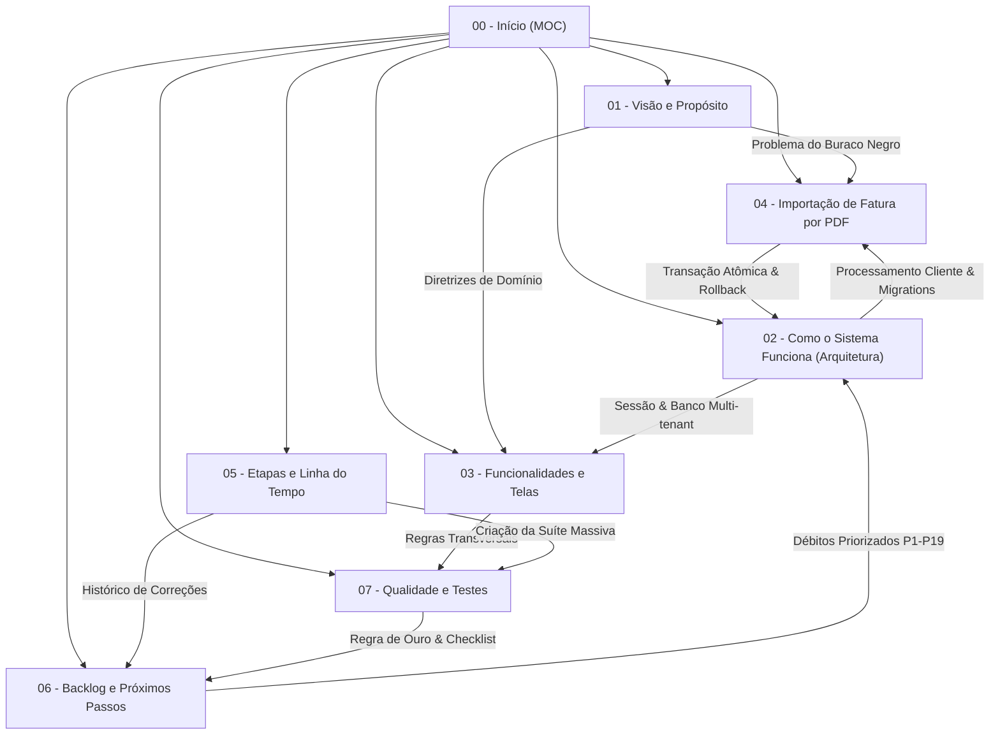

# 00 - Início (Map of Content)

#moc #visao-geral #projeto #indice

> [!NOTE] Segundo Cérebro do Projeto
> Este vault do Obsidian constitui o repositório central de inteligência, engenharia, regras de negócio e documentação viva do projeto **Finanças Pessoais (Finance Dashboard)**. Todas as notas utilizam links bidirecionais (no formato wikilink `\[\[Nome da Nota\]\]`) para permitir navegação estruturada e contextualizada.

---

## 🗺️ Mapa de Navegação do Conhecimento

O projeto está estruturado em **8 notas fundamentais**, interconectadas por decisões de engenharia, arquitetura de software, modelo de dados e garantias de qualidade:

---

## 📚 Índice Estruturado das Notas

| Nota | Tema Principal | Descrição Sucinta | Tags Chave |
|---|---|---|---|
| **[[01 - Visão e Propósito]]** | Produto & Problema | A dor da gestão financeira, o problema da "fatura como buraco negro", privacidade inegociável e princípios de domínio. | `#proposito`, `#visao-geral`, `#regras-de-negocio` |
| **[[02 - Como o Sistema Funciona (Arquitetura)]]** | Engenharia & Backend | Stack técnica (Next.js 16, React 19 Compiler, Prisma 7, Supabase), autenticação sem middleware via `proxy.ts`, sessão HMAC-SHA256, arquitetura multi-tenant. | `#arquitetura`, `#backend`, `#banco-de-dados`, `#seguranca` |
| **[[03 - Funcionalidades e Telas]]** | Frontend & Domínio | Visão detalhada de todas as rotas (`/`, `/transactions`, `/categories`, `/planning`, `/investments`, `/reports`, `/settings`), cálculo de saldos e solução de fusos horários. | `#funcionalidades`, `#telas`, `#frontend`, `#ux` |
| **[[04 - Importação de Fatura por PDF]]** | Feature em Destaque | Pipeline completo de extração com `pdfjs-dist` no navegador, heurística de parsing, sugestão em 3 camadas, conferência de totais, gravação atômica e rollback. | `#fatura-pdf`, `#parsers`, `#seguranca`, `#inovacao` |
| **[[05 - Etapas do Projeto e Linha do Tempo]]** | Evolução & Histórico | Linha do tempo desde o MVP até a branch `feat/importacao-fatura-pdf`, incluindo a grande auditoria de 12/10/2026 e a rodada de correções críticas. | `#historico`, `#linha-do-tempo`, `#evolucao`, `#marcos` |
| **[[06 - Backlog, Pendências e Próximos Passos]]** | Roadmap & Débitos | Pendências imediatas de deploy/migrations, backlog priorizado de P1 a P19 (Alta, Média, Baixa) e roadmap de faturas reais. | `#backlog`, `#roadmap`, `#pendencias`, `#debito-tecnico` |
| **[[07 - Qualidade e Suíte de Testes]]** | Confiabilidade & CI | Pirâmide de 1.288 testes (Vitest + Playwright E2E), estratégias de simulação, Postgres embutido, fuso travado e regras de ouro do `AGENTS.md`. | `#testes`, `#qualidade`, `#vitest`, `#playwright`, `#engenharia` |

---

## 📊 Painel de Status Geral do Projeto

- **Versão Atual do Código:** Branch `feat/importacao-fatura-pdf` (baseada na auditoria e consolidação da branch `docs-testes-melhorias`).
- **Ambiente de Produção Ativo:** Vercel (`finance-project-henna.vercel.app`) conectado ao banco Supabase PostgreSQL.
- **Cobertura de Código Atual:**
  - **97,1%** das linhas
  - **96,7%** dos ramos (branches)
  - **90,8%** das funções
  - **1.288 testes automatizados** no total (1.160 Vitest + 128 Playwright).
- **Pendências Críticas de Banco (Migrations a Aplicar):**
  1. `20261012000000_drop_legacy_budget_index`: Elimina o índice global legado da tabela `budgets` que impedia usuários distintos de possuírem orçamentos com mesmo nome e mês.
  2. `20261013000000_add_invoice_import`: Cria as tabelas `import_batches`, `import_batch_items` e `category_rules`.

---

## 🎯 Conceitos-Chave e Diretrizes Rápidas

> [!IMPORTANT] Leis Fundamentais da Base de Código
> 1. **Next.js 16 & React 19:** O React Compiler está ativado. Mutações diretas de estado são estritamente proibidas.
> 2. **Sem Server Actions:** Toda e qualquer mutação de dados é trafegada via Route Handlers REST (`/api/*`), consumida por serviços tipados (`src/services/*.ts`) que disparam exceções `ApiError`.
> 3. **Sem middleware.ts:** O guardião global de rotas é implementado em `src/proxy.ts` (convenção moderna do Next 16).
> 4. **Tratamento Seguro de Datas:** Toda transação e prazo de meta é gravado como data civil pura (meia-noite UTC). Nunca utilize `new Date().toISOString().slice(...)` ou métodos locais sem o auxílio centralizado de `src/utils/dates.ts`.
> 5. **Regra de Ouro Pré-Commit:** Antes de qualquer commit, é mandatório executar com sucesso: `npm run lint`, `npm run typecheck` e `npm test`.

---
*Vault gerado automaticamente com base nos documentos vivos do repositório em Outubro/2026.*
