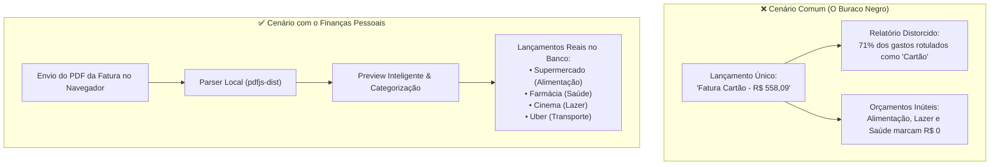

# 01 - Visão e Propósito

#visao-geral #proposito #regras-de-negocio #produto #seguranca

> [!NOTE] O Ponto de Partida
> Este documento esclarece a razão de ser do **Finanças Pessoais**, os problemas estruturais que ele resolve, a dor central identificada no uso de cartões de crédito, suas premissas de privacidade e os pilares de produto que guiam cada decisão técnica.

---

## 🎯 Por que o Sistema Existe?

A gestão financeira pessoal no Brasil enfrenta um dilema clássico de mercado:

1. **Planilhas Eletrônicas:** Oferecem flexibilidade e privacidade, porém impõem alta fricção manual diária, demandam fórmulas complexas, quebram em telas móveis e não possuem automações determinísticas de entrada.
2. **Aplicativos Comerciais Tradicionais (SaaS Proprietários):** Exigem credenciais bancárias (Open Finance invasivo), cobram assinaturas recorrentes caras, exibem anúncios de empréstimos indesejados e monetizam os dados comportamentais do usuário.
3. **Complexidade Excessiva:** Muitos softwares tentam abraçar contabilidade empresarial, confundindo pessoas que necessitam apenas de **clareza de fluxo de caixa, orçamento por envelopes e controle de metas**.

O **Finanças Pessoais** nasceu como um sistema completo, elegante e com experiência de SaaS moderno (tema escuro de alto contraste, tipografia limpa, gráficos interativos e tempo de resposta instantâneo), mantendo o **controle e a soberania total dos dados** sob responsabilidade do usuário.

---

## 🕳️ A Grande Dor: A Fatura de Cartão como "Buraco Negro"

Durante a exploração do aplicativo em produção com dados de uma conta real (auditoria de 12/10/2026 documentada em `[[05 - Etapas do Projeto e Linha do Tempo]]`), constatou-se o fenômeno mais comum e nocivo da gestão financeira moderna:

### O Impacto do Buraco Negro
Quando o usuário registra a fatura do cartão como uma despesa única consolidada:
- **Cegueira Orçamentária:** Os orçamentos mensais de categorias (`[[03 - Funcionalidades e Telas#5-planejamento-de-orçamentos-e-metas]]`) tornam-se inoperantes. O usuário não sabe se extrapolou o limite de alimentação fora de casa, farmácia ou transporte por aplicativo, pois tudo foi engolido pelo rótulo genérico "Cartão".
- **Distorção em Relatórios:** Gráficos de distribuição por categoria (`[[03 - Funcionalidades e Telas#7-relatórios]]`) exibem um bloco gigante rotulado como "Cartão de Crédito", impossibilitando qualquer análise preditiva ou corte seletivo de despesas.
- **Perda de Histórico de Compras Parceladas:** Compras divididas em 10x ou 12x perdem sua identificação temporal e de saldo devedor futuro.

A solução desenvolvida na nota `[[04 - Importação de Fatura por PDF]]` ataca diretamente essa dor, transformando um arquivo PDF estático em dezenas de transações classificadas, conferidas e conciliadas, sem esforço de digitação manual.

---

## 🛡️ Isolamento, Privacidade e Princípio Zero-Trust

Em tempos de vazamentos frequentes e exploração abusiva de telemetria, o Finanças Pessoais foi desenhado sob premissas estritas de proteção ao usuário:

### 1. O PDF Nunca Sai do Seu Navegador
Na funcionalidade de importação, o arquivo PDF da fatura é processado **exclusivamente na memória do navegador do usuário** por meio de Web Workers da biblioteca `pdfjs-dist`. 
- Nenhum byte do documento bancário é enviado a servidores da Vercel, Supabase ou provedores de IA terceiros.
- O servidor recebe apenas um payload JSON estruturado com os dados já anonimizados e prontos para conferência.
- O hash criptográfico SHA-256 do arquivo é calculado localmente apenas para evitar reimportações acidentais do mesmo arquivo.

### 2. Isolamento Rígido Multi-tenant por `userId`
O sistema é multiusuário, mas opera com isolamento lógico hermético:
- Toda operação de leitura, gravação, atualização (`PATCH`) ou exclusão (`DELETE`) é condicionada imperativamente pelo identificador de autenticação `userId` obtido do cookie de sessão assinado (`[[02 - Como o Sistema Funciona (Arquitetura)#2-arquitetura-de-autenticação-e-segurança]]`).
- Tentativas de acesso ou manipulação a registros pertencentes a outro usuário retornam invariavelmente `404 Not Found` (jamais `403 Forbidden`, impedindo a descoberta da existência de registros de terceiros).
- Nenhuma rota de API confia no corpo (`body`) da requisição para definir a qual usuário o registro pertence.

---

## 👥 Público-Alvo e Casos de Uso

| Perfil de Usuário | Necessidade Principal | Como o Sistema Atende |
|---|---|---|
| **Profissionais e Estudantes Organizados** | Acompanhar receitas e despesas sem gastar mais que 5 minutos semanais. | Dashboard intuitivo, cadastro rápido com teclas de atalho e filtros avançados. |
| **Usuários Intensivos de Cartão de Crédito** | Conciliar múltiplas compras parceladas e estornos sem perder a cabeça. | Importação via PDF (`[[04 - Importação de Fatura por PDF]]`) com conferência automática do valor total faturado. |
| **Poupadores e Investidores Iniciantes** | Acompanhar a taxa de poupança mensal e a evolução dos aportes patrimoniais. | Telas de Investimentos e Relatórios com cálculo automático de taxa de economia (`calculateSavingsRate`). |
| **Planejadores com Metas Claras** | Guardar dinheiro para reserva de emergência, viagens ou aquisição de bens. | Módulo de Metas financeiras com barra de progresso visual e cálculo de tempo até o prazo final. |

---

## 🏛️ Premissas Centrais de Engenharia

O desenvolvimento do sistema orienta-se por diretrizes técnicas inegociáveis:

1. **Arquitetura Web Moderna e Robusta:** Adoção de Next.js 16 (App Router) e React 19 com o novo React Compiler habilitado.
2. **Determinismo sobre "Mágica":** Não há dependência de inteligências artificiais com alucinações para extração básica de dados. O parser de faturas é baseado em heurísticas matemáticas determinísticas e regras de negócio testadas exaustivamente.
3. **Consistência Atômica:** Qualquer operação em lote (como importação de 50 transações de uma fatura ou cadastro de usuário com 18 categorias padrão) roda sob transações ACID do PostgreSQL (`$transaction`). Se uma linha falhar, **nada é gravado**.
4. **Precisão Temporal e Fusos Horários:** Datas financeiras são datas civis puras (dia, mês e ano). O sistema não permite que diferenças de fuso horário entre o navegador (ex.: Brasília GMT-3) e servidores em nuvem (UTC) alterem o dia do lançamento (ver solução profunda em `[[03 - Funcionalidades e Telas#9-regras-transversais-de-negócio-e-tratamento-de-datasfusos]]`).
5. **Cultura de Testes Obsessiva:** Nada é promovido para a branch principal sem cobertura automatizada nas 4 camadas: Unitária, API, UI e End-to-End (E2E), atingindo mais de 97% de cobertura de código (`[[07 - Qualidade e Suíte de Testes]]`).

---
*Próxima leitura recomendada: [[02 - Como o Sistema Funciona (Arquitetura)]] para entender os detalhes de infraestrutura e segurança.*
