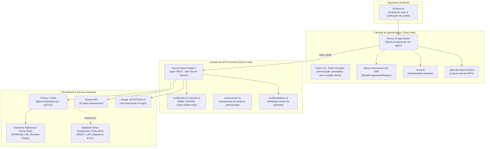
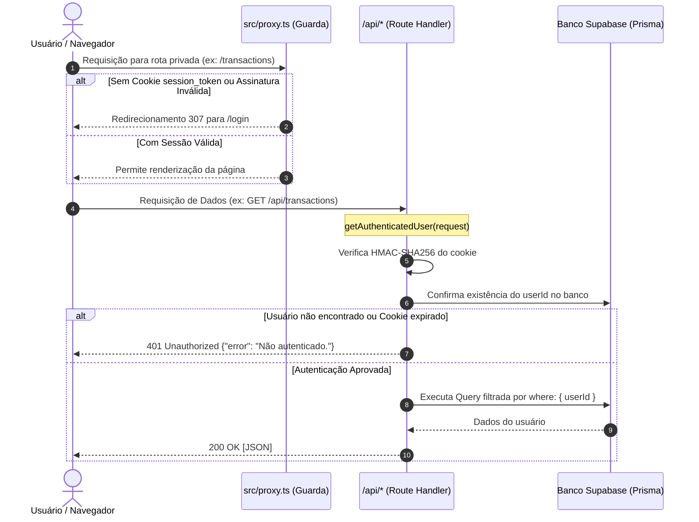
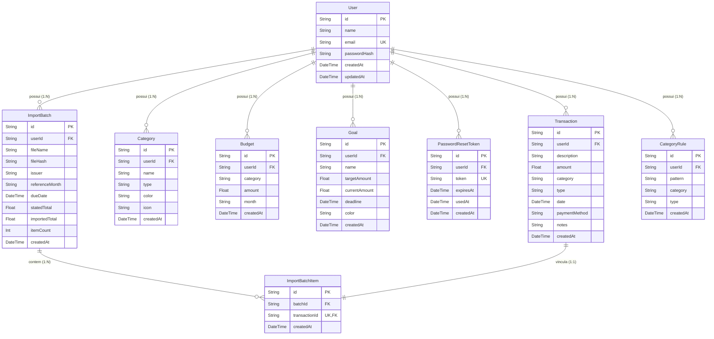

# 02 - Como o Sistema Funciona (Arquitetura)

#arquitetura #backend #banco-de-dados #seguranca #nextjs #prisma

> [!NOTE] Engenharia Sob o Capô
> Esta nota detalha a infraestrutura de software, a stack técnica completa, o mecanismo de proteção de rotas sem `middleware.ts`, o fluxo criptográfico de autenticação stateless e o modelo de dados relacional com isolamento multiusuário estrito.

---

## 🛠️ 1. Stack Tecnológica Detalhada

O sistema é construído sobre a versão mais recente do ecossistema React/Next.js, com foco em performance de ponta e tipagem estrita de ponta a ponta:

### Componentes Chave da Stack:
1. **Next.js 16 (App Router) & React 19:**
   - Todas as páginas operam como Client Components (`"use client"`), com exceção do layout raiz (`src/app/layout.tsx`) e da rota de redirecionamento (`src/app/budgets/page.tsx`).
   - O **React Compiler** está ativado em `next.config.ts:4`. Isso significa que o compilador otimiza automaticamente re-renderizações e dependências, tornando a mutação direta de estados proibitiva.
2. **styled-components com SSR:**
   - Configurado via `src/lib/registry.tsx` (`StyledComponentsRegistry`) para coletar e injetar os estilos durante o Server-Side Rendering inicial, eliminando Flash of Unstyled Content (FOUC) e garantindo tema escuro homogêneo (`src/styles/global.ts`).
3. **Prisma 7 com Driver Adapter:**
   - Adota o adaptador nativo `@prisma/adapter-pg` acoplado a uma pool de conexões `pg.Pool` (`src/lib/prisma.ts`), garantindo compatibilidade com ambientes serverless modernos.
4. **Arquitetura de Conexão Dupla (Supabase):**
   - **`DATABASE_URL` (Porta 6543):** Conexão intermediada pelo PgBouncer do Supabase em modo transação, utilizada pela aplicação em tempo de execução para evitar saturação de processos PostgreSQL.
   - **`DIRECT_URL` (Porta 5432):** Conexão direta TCP com o banco PostgreSQL, utilizada exclusivamente pelo Prisma CLI e pelas migrations (`prisma.config.ts`). **Atenção:** Sem essa variável no `.env`, o comando `prisma generate` no postinstall do `npm install` falhará imediatamente.
5. **Comunicação por Route Handlers REST:**
   - O projeto rejeita intencionalmente *Server Actions* em favor de rotas REST explícitas (`/api/*`), favorecendo previsibilidade de status HTTP (`200`, `201`, `400`, `401`, `404`, `409`, `500`), separação de responsabilidades e facilidade para criação de suítes de testes automatizados (`[[07 - Qualidade e Suíte de Testes]]`).

---

## 🔒 2. Autenticação e Segurança (Sem `middleware.ts`)

### Por que não há `middleware.ts`?
No Next.js 16, a convenção moderna introduzida adota o arquivo **`src/proxy.ts`** como interceptador de requisições. 

### O Guarda de Rotas (`src/proxy.ts`):
- Monitora as rotas declaradas em `rotasProtegidas` (`/`, `/transactions`, `/investments`, `/planning`, `/categories`, `/budgets`, `/reports`, `/settings`, `/import`).
- Caso o usuário não possua cookie válido, redireciona compulsoriamente para `/login`.
- Caso o usuário autenticado tente acessar `/login`, redireciona diretamente para `/` (Dashboard).
- As rotas `/api/*` não passam pelo proxy; cada Route Handler realiza sua própria validação hermética via `getAuthenticatedUser`.

### Criptografia e Estrutura da Sessão (`src/lib/session.ts`):
- **Cookie `session_token`:**
  - Flags: `httpOnly: true`, `sameSite: "lax"`, `secure: process.env.NODE_ENV === "production"`, `path: "/"`.
  - Validade estrita: **30 dias**.
  - Formato: `base64url(payloadJSON).base64url(assinaturaHMAC)`
  - Payload: `{ userId: string, email: string, exp: number }`
- **Validação em Tempo Constante:**
  - A verificação da assinatura utiliza a Web Crypto API nativa com `crypto.subtle.verify`.
  - Isso elimina vulnerabilidades de *timing attacks* (ataques de temporização onde um invasor deduz a assinatura correta medindo a velocidade de falha da comparação de strings `!==`).
  - Tokens sem expiração numérica (`exp`) são rejeitados de imediato.
- **Isolamento de Segurança:**
  - A chave mestra `SESSION_SECRET` exige no mínimo 32 caracteres; se ausente ou curta, o sistema lança erro imediatamente, abortando execuções inseguras.

### Endurecimento do Fluxo de Login e Recuperação:
1. **Defesa contra Enumeração de Contas:**
   - Quando um e-mail inexistente tenta efetuar login, o sistema executa a comparação de senha contra um *hash bcrypt falso/dummy*. Isso faz com que o tempo de resposta da API seja idêntico ao de uma conta real, impedindo que invasores descubram se um e-mail existe no banco através da latência de resposta.
2. **Rate Limiting de Tentativas:**
   - 5 tentativas a cada 15 minutos por chave combinada `email:ip` (em memória de processo; ver melhoria pendente P2 em `[[06 - Backlog, Pendências e Próximos Passos]]`).
3. **Google reCAPTCHA v3:**
   - No login, valida o token enviado junto ao Google via `https://www.google.com/recaptcha/api/siteverify`. Confere se `action === "login"` e se o `hostname` bate com o cabeçalho `host` da requisição.
4. **Recuperação de Senha com Invalidação Atômica:**
   - `/api/auth/forgot-password` emite token UUID com validade de 1 hora.
   - Antes de gerar um novo token, todos os tokens anteriores não utilizados daquele usuário são invalidados.
   - Responde sempre status `200` indiferente do e-mail existir ou da entrega do Resend falhar, preservando sigilo.
   - `/api/auth/reset-password` altera a senha (criptografada em bcrypt com 12 rounds) e marca o token como usado dentro de uma única transação atômica de banco.

---

## 🗄️ 3. Modelo de Dados e Isolamento Multiusuário

O banco de dados relacional (PostgreSQL) é modelado via Prisma com foco em **multi-tenancy lógico** (isolamento de dados por inquilino):

### Detalhamento das Entidades e Regras de Integridade:

| Tabela / Modelo | Chaves & Restrições Únicas | Comportamento e Particularidades |
|---|---|---|
| **`User`** | `email` único (normalizado em minúsculas). | Raiz do multi-tenancy. Todas as relações filhas possuem `onDelete: Cascade`. |
| **`Transaction`** | PK `id` (UUID), index em `[userId]`. | `amount` em Float: **positivo para receitas; negativo para despesas e investimentos**. `category` armazena o **nome textual**, não uma FK. |
| **`Category`** | `@@unique([userId, name, type])` | Permite o mesmo nome caso os tipos sejam diferentes (ex: categoria "Outros" para Receita e "Outros" para Despesa). 18 categorias padrão são injetadas no cadastro. |
| **`Budget`** | `@@unique([userId, category, month])` | Orçamento mensal associado ao nome da categoria e ao mês no formato `YYYY-MM`. |
| **`Goal`** | PK `id`, index em `[userId]`. | Controle de metas. O progresso é manual via atualização de `currentAmount`. |
| **`PasswordResetToken`**| `token` único (UUID v4). | Expira em 1 hora (`expiresAt`). Invalidado com preenchimento de `usedAt`. |
| **`ImportBatch`** | Índices em `[userId]` e `[userId, fileHash]`. | Armazena metadados da fatura importada. O arquivo PDF bruto nunca é gravado no banco. |
| **`ImportBatchItem`** | `transactionId` único, vínculos FK com Cascade. | Tabela de junção. Permite vincular transações a lotes sem poluir a tabela `transactions` com colunas que quebrariam produção antes das migrations. |
| **`CategoryRule`** | `@@unique([userId, pattern])` | Regras automáticas de categorização ("Lembrar para as próximas faturas"). Casamento por padrão de texto normalizado. |

### Garantias de Isolamento Multi-tenant no Backend:
1. **Nunca Confiar no Cliente:** Nenhuma API aceita `userId` vindo do corpo JSON. O `userId` é compulsoriamente injetado a partir da sessão validada (`auth.user.id`).
2. **Prevenção de Fuga de Dados:** Consultas de busca (`findMany`, `findFirst`) possuem cláusula mandatória `where: { userId }`.
3. **Respostas Herméticas:** Operações de alteração (`PATCH`) e exclusão (`DELETE`) utilizam `updateMany` e `deleteMany` filtrando por `{ id, userId }`. Caso um usuário tente manipular o ID de outro usuário, o retorno é `404 Not Found` (nunca `403`), impedindo ataques de enumeração horizontal de recursos (IDOR).

---
*Próxima leitura recomendada: [[03 - Funcionalidades e Telas]] para conhecer a implementação visual e as regras de domínio das telas.*
