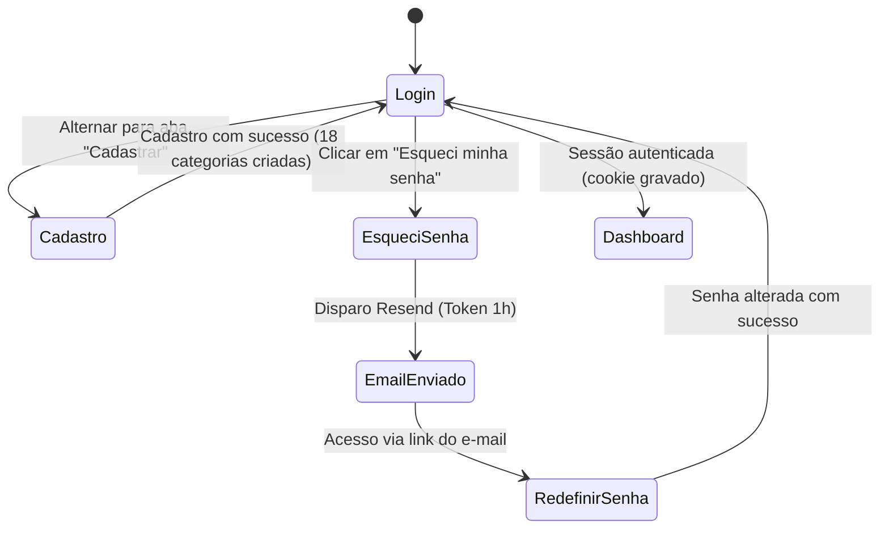
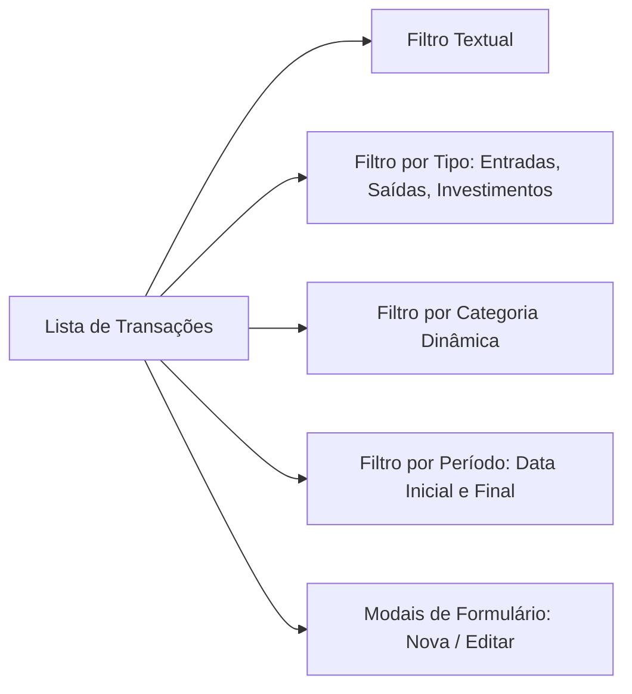
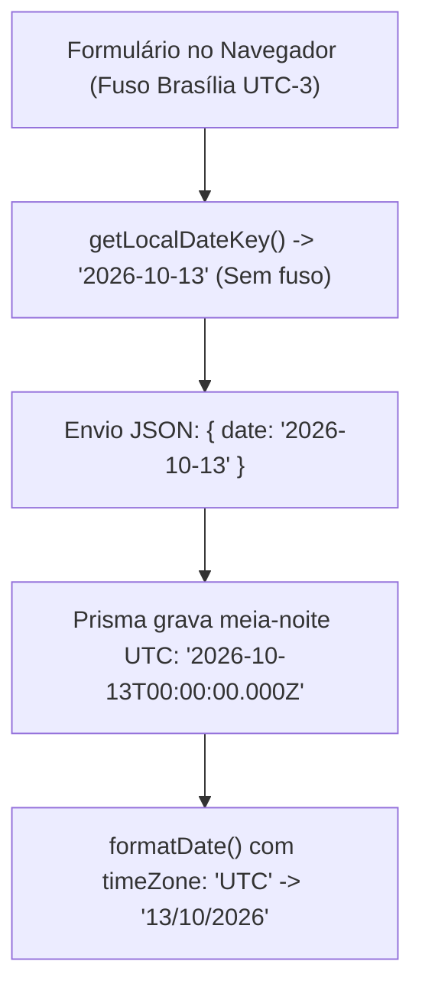

# 03 - Funcionalidades e Telas

#funcionalidades #telas #regras-de-negocio #frontend #ux #calculos

> [!NOTE] Mapa Completo do Frontend
> Este documento apresenta a anatomia de todas as telas do **Finanças Pessoais**, suas rotas, interações de interface, regras de negócio embutidas, convenções matemáticas de saldo e a solução técnica adotada para o tratamento seguro de fusos horários.

---

## 🧭 1. Visão Panorâmica de Rotas e Navegação

O aplicativo organiza-se em torno de uma navegação superior desktop (`AppNavigation`) que se recolhe em um drawer lateral em telas com largura $\le 768\text{px}$ (`src/components/AppNavigation`).

| Rota | Tela / Recurso | Proteção | Descrição Funcional |
|---|---|---|---|
| `/login` | Login e Cadastro | Pública (redireciona para `/` se logado) | Autenticação por e-mail e senha com Google reCAPTCHA v3. |
| `/forgot-password` | Esqueci a Senha | Pública | Solicitação de link de redefinição via e-mail transacional (Resend). |
| `/reset-password` | Redefinir Senha | Pública | Formulário de troca de senha atrelado a token temporário de 1 hora. |
| `/` | Dashboard (Início) | Privada | Visão geral executiva: saldo acumulado, resumo do mês, donut e metas. |
| `/transactions` | Transações | Privada | Tabela interativa com busca, filtros combinados, ordenação e CRUD completo. |
| `/import` | Importar Fatura PDF | Privada | Leitura no navegador de faturas em PDF, preview editável e gravação atômica. |
| `/categories` | Categorias | Privada | Gestão de categorias por tipo (Receita, Despesa, Investimento) e métricas. |
| `/investments` | Investimentos | Privada | Acompanhamento de aportes patrimoniais e histórico dos últimos 6 meses. |
| `/planning` | Planejamento | Privada | Orçamentos mensais com barras de progresso e gestão de metas financeiras. |
| `/budgets` | *(Redirect)* | Privada | Redireciona automaticamente para `/planning` (`src/app/budgets/page.tsx`). |
| `/reports` | Relatórios | Privada | Gráficos mensais de fluxo de caixa, evolução de saldo e média diária. |
| `/settings` | Configurações | Privada | Dados do usuário logado, exportação em JSON/CSV e logout. |

---

## 🖥️ 2. Detalhamento de Telas e Regras de Negócio

### 2.1 Autenticação: Login, Cadastro e Recuperação de Senha

1. **Login & Cadastro (`/login`):**
   - **Abas Unificadas:** Permite alternar instantaneamente entre Login e Cadastro na mesma tela.
   - **Validações de Entrada:** E-mail formatado (normalizado para minúsculas) e senha com comprimento mínimo de 8 caracteres.
   - **reCAPTCHA v3:** Avaliação de score em segundo plano para mitigação de bots sem testes invasivos (captchas visuais).
   - **Injeção de Categorias Padrão:** No cadastro, o sistema cria atomicamente o usuário e **18 categorias padrão** (Receitas: Salário, Freelance, Investimentos, Outros; Despesas: Alimentação, Moradia, Transporte, Saúde, Educação, Lazer, Compras, Contas, Outros; Investimentos: Ações, Renda Fixa, Fundos Imobiliários, Criptomoedas, Outros).
   - **Carregamento e Feedback:** Botões entram em estado desabilitado durante o envio (bloqueando cliques duplos). Mensagens de erro utilizam `role="alert"` e sucessos `role="status"`.
   - **Reidratação de Sessão:** Ao autenticar, executa `window.location.href = "/"` para recarregar a árvore React e inicializar o `TransactionsProvider` com os dados do usuário.

2. **Esqueci a Senha (`/forgot-password`) & Redefinição (`/reset-password`):**
   - Solicitação de redefinição com link de uso único e validade estrita de 60 minutos.
   - A resposta da API é sempre positiva (`200 OK`) mesmo se o e-mail não existir, prevenindo ataques de enumeração de contas.
   - Na redefinição, a presença e validade do token na URL são verificadas. Tokens já usados ou expirados acusam erro claro com link imediato para nova solicitação.

---

### 2.2 Dashboard (`/`) — Visão Geral Executiva

O Dashboard consolida a situação financeira do usuário dividida em duas dimensões temporais:

1. **Cards Superiores (Histórico Acumulado):**
   - **Saldo Total:** Soma de todas as transações de todos os tempos ($\sum \text{Receitas} - \sum \text{Despesas} - \sum \text{Investimentos}$).
   - **Entradas Acumuladas:** Soma de todas as receitas já registradas.
   - **Saídas Acumuladas:** Soma de todas as despesas já registradas.
   - **Investimentos Acumulados:** Soma de todos os aportes já realizados.
2. **Resumo do Mês Corrente:**
   - Calcula os totais estritamente dentro do mês civil atual utilizando `isSameMonth` em timezone seguro.
   - **Taxa de Economia:** Calculada dinamicamente via `calculateSavingsRate(receitas, saldoLiquido)`. Caso o usuário não tenha receitas no mês, exibe `"Sem receitas"`.
3. **Distribuição de Gastos (`ExpenseDonutChart`):**
   - Gráfico de rosca (`recharts`) categorizando as despesas do mês por volume financeiro.
4. **Insight de Metas:**
   - Algoritmo que varre as metas cadastradas e exibe em destaque a meta em andamento que possui a data de término (`deadline`) mais próxima no futuro.
5. **Últimas Transações (`LatestTransactions`):**
   - Tabela simplificada exibindo os 5 lançamentos mais recentes com badge colorido de tipo e valor formatado em BRL.

---

### 2.3 Transações (`/transactions`) — O Coração Operacional

A tela central onde o usuário pesquisa, audita e opera lançamentos financeiros:

- **Filtros Combinados em Memória:**
  - Busca em tempo real sobre a descrição do lançamento.
  - Seletor de Tipo (Todos, Entradas, Saídas, Investimentos).
  - Seletor dinâmico de Categoria (populado pelas categorias do usuário).
  - Intervalo de datas: campos "De" e "Até" operando sobre strings civis `AAAA-MM-DD` (`getDateKey`), sem desvios de fuso.
- **Formulário de Transação (`TransactionForm`):**
  - Campos: Descrição, Valor, Categoria, Data, Tipo, Forma de Pagamento e Observações.
  - Campo de valor travado com `min="0.01"` e `step="0.01"`, impedindo zeros ou negativos que invertam o sinal da operação.
  - Data inicial pré-preenchida com `getLocalDateKey()` (a data do dia de hoje no fuso local do usuário, mesmo após as 21h).
  - Na edição, mantém a data original do registro gravado em UTC (`getDateKey(transaction.date)`), sem empurrá-la inadvertidamente para "hoje".
- **Feedback de Exclusão e Erro:**
  - Confirmação de exclusão cita explicitamente o nome da despesa.
  - Se a API retornar erro (`400`, `404`, `500`), o formulário não fecha e renderiza o componente `FormError` informando a causa exata devolvida pela API.

---

### 2.4 Categorias (`/categories`)

- **Classificação Rígida por Tipo:**
  - Cada categoria pertence a uma das três naturezas financeiras: `income` (Receita), `outcome` (Despesa) ou `investment` (Investimento).
- **Cards Informativos com Métricas em Tempo Real:**
  - Cada card exibe sua sigla/ícone (2 letras), cor personalizada e duas métricas:
    1. **Total Acumulado:** Toda a movimentação histórica daquela categoria.
    2. **Total no Mês:** Gastos ou recebimentos daquela categoria no mês corrente.
  - **Atenção:** As métricas consideram tanto o nome quanto o tipo para evitar que categorias com mesmo nome (ex.: "Outros" em despesa e "Outros" em receita) misturem seus valores.
- **Formulário de Categoria:**
  - Validação de unicidade no banco: `@@unique([userId, name, type])`.

---

### 2.5 Investimentos (`/investments`)

- Tela dedicada à evolução patrimonial através de aportes regulares:
  - **Total Investido Acumulado:** Soma de todos os registros de tipo `investment` em valor absoluto (`|amount|`).
  - **Aportes do Mês:** Soma dos investimentos realizados no mês civil em curso.
  - **Ação "+ Novo Aporte":** Dispara o modal de transação já com o tipo `investment` pré-selecionado, evitando que aportes sejam salvos acidentalmente como despesas operacionais.
  - **Gráfico de Evolução (6 Meses):** Barras mensais demonstrando o histórico recente de aportes.

---

### 2.6 Planejamento: Orçamentos e Metas (`/planning`)

Combina orçamentação preventiva e acompanhamento de metas financeiras na mesma interface:

#### Orçamentos Mensais (`Budget`)
- O usuário define um teto de gastos para uma categoria em um determinado mês (`YYYY-MM`).
- A barra de progresso visual calcula em tempo real a proporção gasta:

$$\text{Progresso} = \left(\frac{\text{Despesas Reais da Categoria no Mês}}{\text{Teto Orçado}}\right) \times 100$$

- **Faixas Visuais de Alerta:**
  - 🟢 **Normal ($< 80\%$):** Barra verde. Gasto sob controle.
  - 🟡 **Atenção ($80\% \text{ a } 99\%$):** Barra amarela. Próximo do limite estipulado.
  - 🔴 **Ultrapassado ($\ge 100\%$):** Barra vermelha com aviso "Limite ultrapassado".
- Ao clicar em "+ Novo Orçamento", o modal abre automaticamente preenchido com o mês em visualização.

#### Metas Financeiras (`Goal`)
- Permite estipular objetivos de economia (ex.: "Reserva de Emergência", "Viagem", "Entrada do Carro").
- Campos: Nome, Valor Alvo (`targetAmount`), Valor Atual Acumulado (`currentAmount`), Prazo Final (`deadline`) e Cor.
- Exibe porcentagem concluída, valor faltante e contagem regressiva de dias até o vencimento.

---

### 2.7 Relatórios (`/reports`)

Análise detalhada do comportamento financeiro para qualquer mês selecionado:
- **Seletor de Mês:** Permite navegar para meses anteriores ou futuros.
- **Entradas vs Saídas (`IncomeOutcomeBarChart`):** Comparativo visual em colunas.
- **Evolução do Saldo (`BalanceLineChart`):** Gráfico de linha exibindo o resultado financeiro mensal.
- **Tabela de Despesas por Categoria:** Relação com nome, valor consumido e porcentagem do total de despesas daquele mês.
- **Média Diária Inteligente de Gastos:**
  - Se for o mês corrente: divide o total de gastos pelos **dias já decorridos** até hoje.
  - Se for um mês passado: divide pelo **total de dias do mês** (ex.: 30 ou 31 dias).

---

### 2.8 Configurações (`/settings`)

- **Perfil do Usuário:** Consulta de metadados da conta via `GET /api/me` (Nome, E-mail, data de cadastro).
- **Exportação de Dados:**
  - **JSON Completo:** Download estruturado de todas as transações em formato nativo.
  - **CSV Tabulado:** Arquivo compatível com Microsoft Excel e Google Sheets com formatação em BRL e cabeçalhos em português.
- **Encerramento de Sessão:** Botão de Logout que invoca `POST /api/logout` para expirar o cookie de sessão e redirecionar para a tela pública.

---

### 2.9 Importação de Fatura por PDF (`/import`)

- Rota especializada para conciliação bancária inteligente via upload de fatura em PDF. Detalhada integralmente na nota `[[04 - Importação de Fatura por PDF]]`.

---

## 🧮 3. Regras Transversais de Negócio e Cálculos

### 3.1 Convenção de Sinais de `amount`
Para simplificar somas no banco de dados e evitar divergências de modelo, o sistema estabelece:

| Natureza da Transação | Tipo (`type`) | Sinal Gravado em `amount` |
|---|---|---|
| **Receita (Entrada)** | `income` | **Positivo** ($+X$) |
| **Despesa (Saída)** | `outcome` | **Negativo** ($-X$) |
| **Investimento (Aporte)** | `investment` | **Negativo** ($-X$) |

> [!IMPORTANT] Por que investimento tem sinal negativo?
> Porque, do ponto de vista do fluxo de caixa da conta corrente, o dinheiro que sai para uma corretora ou aplicação não está mais disponível para gastos imediatos. Logo, no cálculo do saldo da conta corrente:
> $$\text{Saldo Líquido} = \sum \text{Receitas} - \sum \text{Despesas} - \sum \text{Investimentos}$$

---

### 3.2 A Solução Definitiva de Datas e Fusos Horários (`src/utils/dates.ts`)

Transações financeiras e prazos de metas são **datas civis puras** (ex.: "13 de Outubro de 2026"). No entanto, quando um navegador em fuso horário negativo (ex.: Horário de Brasília, UTC-3) envia uma data como ISO string ou o backend grava meia-noite em UTC (`2026-10-13T00:00:00.000Z`), uma conversão ingênua via `toLocaleDateString()` subtrai 3 horas, transformando a data em `12/10/2026 21:00`.

Para erradicar definitivamente esse problema (erros A1 a A4 da auditoria), foi construído o módulo centralizado `src/utils/dates.ts`:

| Função Helper | Comportamento e Regra | Onde é Aplicada |
|---|---|---|
| `getDateKey(date)` | Extrai a string `AAAA-MM-DD` a partir do instante UTC gravado. | Filtros De/Até e valor inicial de formulários de edição. |
| `getMonthKey(date)` | Extrai a chave de mês `AAAA-MM` sob a perspectiva UTC. | Agrupamentos em Relatórios, Planejamento e Investimentos. |
| `getLocalDateKey(d)` | Extrai `AAAA-MM-DD` da data e hora local do computador do usuário. | Data sugerida por padrão em formulários de novos lançamentos. |
| `getLocalMonthKey(d)` | Extrai `AAAA-MM` do mês atual no fuso local. | Abertura padrão de telas mensais. |
| `dateKeyToISOString(key)` | Converte `AAAA-MM-DD` para string ISO meia-noite UTC (`T00:00:00.000Z`). | Envio do prazo de metas financeiras. |

---
*Próxima leitura recomendada: [[04 - Importação de Fatura por PDF]] para conhecer o funcionamento detalhado do parser e conciliador de faturas.*
