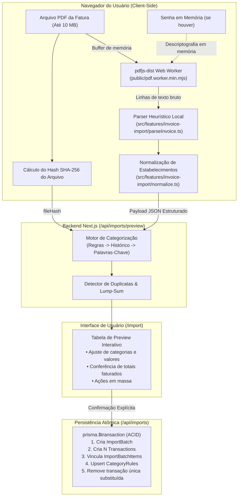
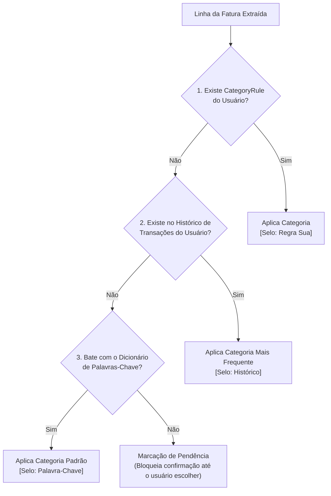
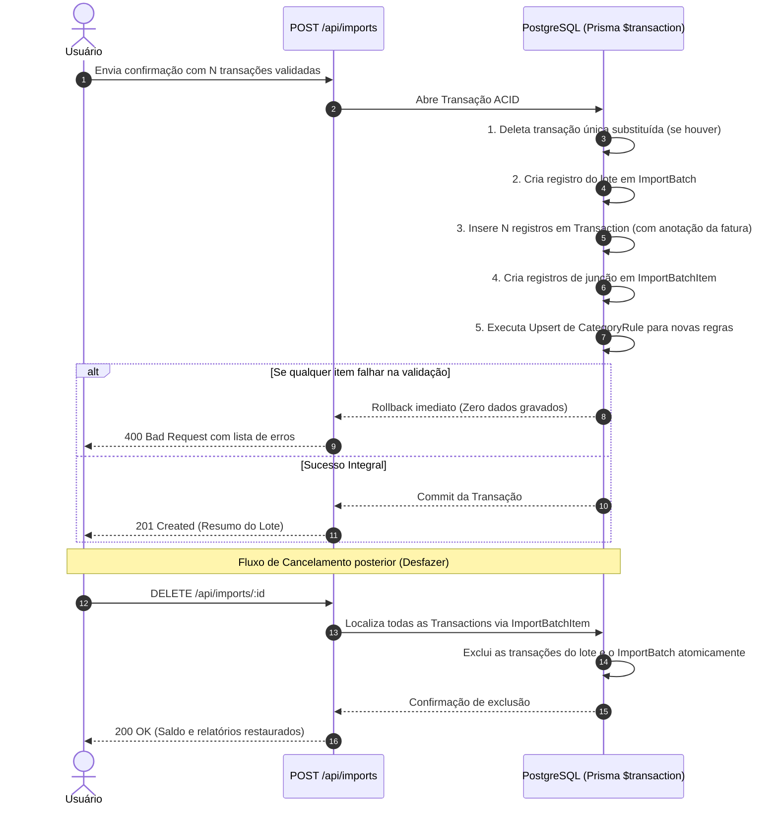

# 04 - Importação de Fatura por PDF

#fatura-pdf #parsers #seguranca #regras-de-negocio #inovacao #heuristica

> [!NOTE] Destaque de Engenharia do Projeto
> Esta nota detalha a funcionalidade de importação inteligente de faturas de cartão de crédito em PDF: processamento local no navegador via `pdfjs-dist`, heurísticas de parsing, motor de categorização em 3 camadas, conferência matemática de totais, gravação atômica no banco e capacidade de rollback integral.

---

## 🎯 1. Motivação e Arquitetura de Privacidade

A importação de fatura resolve o problema do "buraco negro" (`[[01 - Visão e Propósito#a-grande-dor-a-fatura-de-cartão-como-buraco-negro]]`), onde compras pulverizadas de cartão eram consolidadas em uma despesa única no fim do mês.

### Por que processar no Navegador? (Zero-Trust Banking)
Diferente de soluções convencionais que enviam o arquivo PDF para servidores em nuvem ou APIs terceiras de LLM, o Finanças Pessoais executa a extração **100% no cliente**:

- **Privacidade Bancária Absoluta:** O arquivo PDF nunca é transmitido pela rede nem armazenado no Supabase ou Vercel.
- **Suporte a Arquivos Protegidos:** Faturas que exigem senha (ex.: dígitos do CPF em faturas do Nubank, Itaú ou Bradesco) recebem a senha através de um campo local; a senha vive apenas na memória volátil do navegador durante a sessão.
- **Sem Limites de Payload Serverless:** Evita os limites estritos de corpo de requisição da Vercel (geralmente ~4,5 MB).

---

## ⚙️ 2. Heurística do Parser e Linhas Especiais

A extração de texto converte os glifos do documento em linhas sequenciais estruturadas através do arquivo `src/features/invoice-import/parseInvoice.ts`:

### 2.1 Detecção de Padrões por Expressões Regulares
- **Formatos de Data Suportados:**
  - `DD/MM` (ex.: `15/09`)
  - `DD/MM/AAAA` (ex.: `15/09/2026`)
  - `DD MMM` (ex.: `15 SET`, `02 OUT`)
- **Formatos de Valores Monetários:**
  - `1.234,56` ou `R$ 1.234,56`
  - Valores negativos ou marcados com sinal de crédito (`CR` ou estorno).
- **Detecção de Parcelas:**
  - Padrões `(X/Y)` ou `X/Y` (ex.: `03/10`, `(02/06)`), identificando o número da parcela corrente e o total de prestações.
- **Metadados do Cabeçalho:**
  - Identificação automática do emissor (Nubank, Itaú, Santander, Bradesco, Inter, C6, etc.).
  - Mês de referência da fatura (`referenceMonth` no formato `YYYY-MM`).
  - Data de vencimento da fatura (`dueDate`).
  - Total faturado impresso na fatura (`statedTotal`).

### 2.2 Tratamento de Linhas Especiais

| Tipo de Linha no PDF | Como o Parser Trata | Regra de Negócio |
|---|---|---|
| **Pagamento Recebido / Pagamento de Fatura** | Detectado e desmarcado (`include: false`) por padrão. | Corresponde à quitação da fatura do mês anterior; incluí-lo como despesa geraria duplicidade de gastos. |
| **Estornos e Créditos** | Convertido para Tipo Receita (`income`). | Aparece com badge positivo e sinal `+` para abater as despesas gerais daquele período. |
| **IOF, Anuidade, Multas e Juros** | Classificado como Despesa (`outcome`). | Sugestão automática direcionada para a categoria "Contas" ou regra do usuário. |
| **Subtotais, Saldos Anteriores e Cabeçalhos** | Descartados pelo filtro de ruído. | Não representam transações individuais de consumo. |

---

## 🔤 3. Normalização de Estabelecimento

Faturas de cartão frequentemente poluem os nomes dos estabelecimentos com códigos de adquirentes, cidades e parcelas (ex.: `PAG*JoseSilva 03/10 SAO PAULO BR`).

A função de normalização (`src/features/invoice-import/normalize.ts`) limpa essas strings:
1. Converte todos os caracteres para **MAIÚSCULAS** e remove acentuações (`SÃO PAULO` $\to$ `SAO PAULO`).
2. Remove prefixos conhecidos de intermediadores e maquininhas:
   - `PAG*`, `MP*`, `IFD*`, `PAYPAL*`, `SUMUP*`, `STONE*`, `CIELO*`, `REDECARD*`.
3. Remove sufixos de parcelas no final da descrição (`03/10`, `PARC 02`).
4. Remove indicadores finais de país (`BR`, `BRA`).
5. **Resultado:** Uma chave limpa e determinística (ex.: `JOSE SILVA`) usada como padrão (`pattern`) para geração de regras e casamento com histórico.

---

## 🧠 4. Motor de Sugestão de Categorias em 3 Níveis

Quando o payload de linhas extraídas atinge o endpoint `/api/imports/preview`, o sistema aciona uma esteira de inteligência determinística em cascata de prioridades:

1. **Nível 1 — Regra do Usuário (`CategoryRule`):**
   - Prioridade máxima. Casamento exato sobre o estabelecimento normalizado gravado previamente pelo usuário na opção "Lembrar para as próximas faturas".
   - Selo visual na interface: **"Regra sua"**.
2. **Nível 2 — Histórico de Transações:**
   - Caso não haja regra cadastrada, busca na tabela `transactions` do próprio usuário os lançamentos passados que contenham descrição normalizada equivalente. A categoria mais vezes utilizada no passado é atribuída.
   - Selo visual: **"Histórico"**.
3. **Nível 3 — Dicionário de Palavras-Chave Padrão (Fallback):**
   - Mapeamento contextual embutido no código que detecta categorias conhecidas com base em palavras-chave no início dos termos:
     - `UBER`, `99APP`, `POSTO`, `SHELL`, `IPIRANGA` $\to$ **Transporte**
     - `IFOOD`, `RESTAURANTE`, `PADARIA`, `MCDONALD`, `BURGER` $\to$ **Alimentação**
     - `DROGASIL`, `PACHECO`, `FARMACIA`, `LABORATORIO` $\to$ **Saúde**
     - `NETFLIX`, `SPOTIFY`, `CINEMA`, `INGRESSO`, `STEAM` $\to$ **Lazer**
   - **Regra de Segurança:** A categoria sugerida só é atribuída se ela efetivamente existir na lista de categorias ativas do usuário.
   - Selo visual: **"Palavra-chave"**.
4. **Sem Sugestão:**
   - A linha fica sem categoria preenchida, acompanhada de um aviso visual. O botão de confirmação do lote é travado até que o usuário defina a categoria manualmente.

---

## 📅 5. Regra Temporal de Parcelas

Compras parceladas surgem na fatura com a data em que a compra física ocorreu originalmente, muitas vezes meses antes. Se gravássemos a data original:
- Uma compra feita em Janeiro parcelada em 10x geraria lançamentos na fatura de Outubro com data de Janeiro.
- Isso reabriria e distorceria meses contábeis passados já encerrados.

**A Solução de Data Efetiva (`getEffectiveDate`):**
- **Compra à Vista ou Parcela 1:** Mantém a **data da compra**.
- **Parcela 2 em diante:** A data é fixada no **mês de referência da fatura**, mantendo o dia civil da compra (ou o último dia do mês se o dia não existir, como dia 31 em meses de 30 dias).
- **Opção Global no Preview:** Alternador que permite "Lançar tudo no mês da fatura" para usuários que realizam controle estrito de caixa pelo mês de pagamento.

---

## 🔍 6. Prevenção de Duplicidades e "Lump-Sum"

O sistema possui 3 barreiras para evitar que o usuário contabilize despesas repetidas:

1. **Reimportação de Arquivo:**
   - Ao analisar o `fileHash` (SHA-256 do arquivo original), a API verifica se já existe um `ImportBatch` com aquele mesmo hash para o usuário. Em caso positivo, exibe o aviso: *"Esta fatura já foi importada em DD/MM/AAAA"*.
2. **Duplicata de Linha:**
   - Verifica se já existe uma transação com a mesma data civil, descrição normalizada e valor exato. As linhas correspondentes vêm desmarcadas por padrão com badge *"Possível duplicata"*.
3. **Substituição da Fatura Única ("Lump-Sum"):**
   - Se o usuário tinha o hábito de registrar um lançamento genérico ("Fatura Nubank R$ 850,00"), a API localiza despesas avulsas no mês cujo valor seja idêntico ao total faturado ($\pm \text{R\$} 0,01$).
   - O preview pergunta: *"Você já registrou esta fatura como um lançamento único de R$ 850,00. Deseja substituí-lo pelo detalhamento destas compras?"*
   - Na confirmação, a transação antiga é excluída e substituída pelas dezenas de transações detalhadas, mantendo o saldo do mês perfeitamente intacto.

---

## ⚖️ 7. Preview Editável e Conferência de Totais

Na tela `/import`, o usuário dispõe de uma interface completa de conciliação:

- **Conferência Obrigatória de Total:**
  - A interface calcula a soma matemática de todos os itens marcados para inclusão e confronta com o `statedTotal` impresso no cabeçalho.
  - Se houver divergência ($\sum \ne \text{Total}$), um alerta em vermelho exibe a diferença (ex.: *"Diferença de R$ 32,50"*). Isso ocorre quando a fatura contém parcelas futuras na mesma página ou linhas ilegíveis.
  - Para prosseguir com divergência, exige-se clique em *"Confirmar mesmo com diferença"*.
- **Ações em Massa no Grid:**
  - Checkbox para marcar/desmarcar todas as linhas.
  - Filtro rápido para exibir "Apenas linhas com pendências/avisos".
  - Ao alterar a categoria de um estabelecimento: opções imediatas de *"Aplicar a todas as linhas de [Estabelecimento]"* e *"Lembrar para as próximas faturas"*.

---

## ⚡ 8. Gravação Atômica e Rollback (Desfazer Importação)

A gravação e a exclusão são desenhadas para garantir integridade absoluta dos dados:

- **Gravação Atômica (`prisma.$transaction`):** Nenhuma transação fica "pela metade". Se a linha 49 de 50 contiver um erro de integridade, todas as 48 anteriores são revertidas instantaneamente.
- **Vínculo Transação-Lote sem Alterar a Tabela Principal:** As transações são ligadas ao lote através da tabela auxiliar `ImportBatchItem` (`transactionId` único). Com isso, a tabela `transactions` mantém-se limpa e retrocompatível.
- **Desfazer Importação Instantâneo:** Na listagem de lotes importados, o usuário pode clicar em *"Desfazer importação"*. O backend deleta todas as transações daquele lote e o próprio lote, recalculando os saldos e gráficos instantaneamente.

---
*Próxima leitura recomendada: [[05 - Etapas do Projeto e Linha do Tempo]] para compreender a evolução histórica e os marcos de desenvolvimento.*
