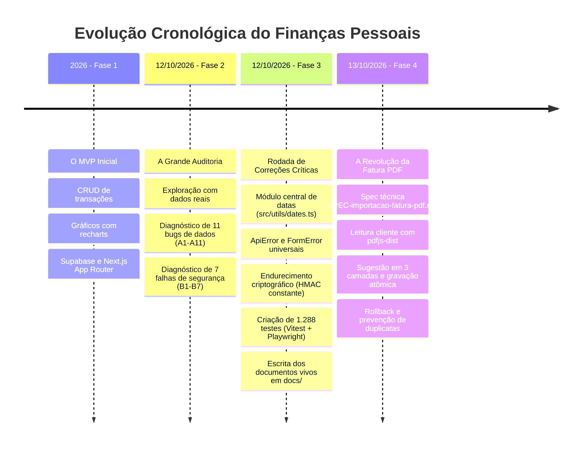
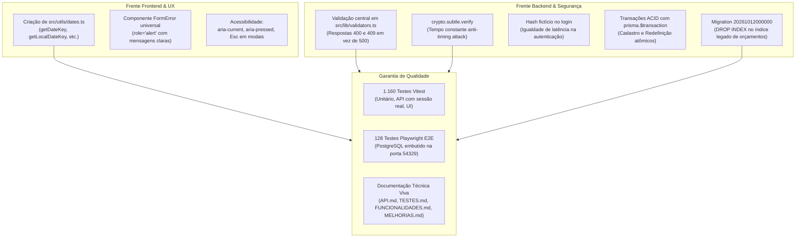

# 05 - Etapas do Projeto e Linha do Tempo

#linha-do-tempo #historico #evolucao #marcos #engenharia

> [!NOTE] A Trajetória de Engenharia
> Esta nota documenta toda a história de evolução do **Finanças Pessoais**, desde a sua concepção inicial como MVP até a branch atual (`feat/importacao-fatura-pdf`), detalhando os diagnósticos da grande auditoria de 12/10/2026, as correções críticas de segurança/fuso horário e a criação da suíte de testes.

---

## 📈 Linha do Tempo e Marcos de Evolução



---

## 🧱 Fase 1: O MVP Inicial e Prova de Conceito

O projeto nasceu com o objetivo de demonstrar a construção de uma aplicação SaaS financeira moderna utilizando o ecossistema Next.js:
- **Funcionalidades Entregues:**
  - Telas de Dashboard, Transações, Categorias, Investimentos, Planejamento (Orçamentos e Metas), Relatórios e Configurações.
  - Integração com Supabase (PostgreSQL) através do Prisma ORM.
  - Tema escuro desenhado com styled-components e visualizações gráficas com recharts.
  - Autenticação stateless baseada em cookie assinado.
- **Limitações e Dívidas do MVP Inicial:**
  - **Zero Testes Automatizados:** O projeto não possuía nenhum teste unitário, de integração ou E2E.
  - **Instabilidade Temporal:** Erros severos de fuso horário que adiantavam ou atrasavam datas de transações e prazos de metas.
  - **Erros Silenciosos:** Formulários que capturavam falhas da API sem avisar o usuário, limpando campos ou fechando modais como se a operação tivesse sido bem-sucedida.
  - **Falhas de Isolamento:** O índice de unicidade da tabela `budgets` havia sido criado globalmente, gerando conflitos entre usuários distintos.

---

## 🔬 Fase 2: A Grande Auditoria de 12/10/2026

Em 12 de Outubro de 2026, foi realizada uma auditoria cirúrgica no código-fonte e na aplicação em produção (`finance-project-henna.vercel.app`), com dados de uma conta real. O diagnóstico revelou problemas estruturais divididos em duas grandes frentes:

### 2.1 Erros que Afetavam os Números ou os Dados (A1 a A11)

| Código | Problema Diagnosticado | Como se Manifestava na Prática |
|---|---|---|
| **A1** | **Datas deslocadas pelo fuso horário** | Uma transação salva com data `13/10` aparecia na lista como `12/10`. Um prazo de meta `31/12` aparecia como `30/12`. O filtro "De/Até" para `13/10` não encontrava o lançamento. |
| **A2** | **"Mês" calculado de formas divergentes** | Transações do dia 1º eram computadas no mês anterior no Dashboard e em Categorias, mas no mês correto em Relatórios e Orçamentos. |
| **A3** | **"Hoje" calculado em UTC** | Após as 21h (horário de Brasília, UTC-3), o formulário de nova transação sugeria a data de amanhã. No último dia do mês, telas abriam no mês seguinte. |
| **A4** | **Edição de transação resetava data para hoje** | Corrigir a descrição de um lançamento de dois meses atrás movia-o silenciosamente para a data atual. |
| **A5** | **Falhas silenciosas de interface** | Criar um orçamento duplicado gerava erro 500 no servidor; o modal continuava aberto, os campos eram limpos e nenhum aviso surgia para o usuário. |
| **A6** | **API respondia 500 para entradas inválidas** | Transação sem valor ou meta negativa eram tratadas como falha interna de servidor em vez de validação de cliente. |
| **A7** | **Métricas de categoria ignoravam o tipo** | Categorias com mesmo nome em tipos diferentes (ex: "Outros" em Receita e "Outros" em Despesa) somavam valores de ambas. |
| **A8** | **"+ Novo Aporte" abria como Saída** | O modal abria com tipo padrão "Saída", fazendo com que aportes salvos sem atenção virassem despesas comuns. |
| **A9** | **Campo Valor aceitava zero e números negativos** | Inserir valor negativo invertia o sinal contábil (uma Saída com valor negativo virava Entrada). |
| **A10** | **Média diária distorcida no mês corrente** | Dividia o total de gastos pelo total de dias do mês (ex: 31), subestimando drasticamente a média diária no início do mês. |
| **A11** | **Orçamento único entre TODOS os usuários** | O índice `[category, month]` não considerava `userId`. Se o Usuário A orçasse "Alimentação" em Outubro, o Usuário B recebia erro ao tentar orçar sua própria "Alimentação". |

### 2.2 Falhas de Segurança e Robustez do Backend (B1 a B7)

| Código | Vulnerabilidade Diagnosticada | Impacto de Segurança |
|---|---|---|
| **B1** | Assinatura da sessão comparada com `!==` | Vulnerável a *timing attacks*. Tokens sem campo `exp` numérico nunca expiravam. |
| **B2** | "Esqueci a senha" revelava existência de contas | Respondia `500` quando a conta existia e o envio falhava, mas `200` para contas inexistentes, permitindo enumeração de usuários. |
| **B3** | Tokens de redefinição não eram invalidados | Solicitar novo link deixava todos os links antigos emitidos ainda ativos. |
| **B4** | Ausência de atomicidade | Cadastro de usuário e injeção de categorias ocorriam em queries soltas; se a segunda falhasse, o usuário ficava órfão de categorias. |
| **B5** | Comparação de senha vulnerável a timing attack | E-mails inexistentes retornavam mais rápido do que e-mails reais, revelando a base de usuários por análise de latência. |
| **B6** | Falhas de rede no reCAPTCHA | Falha temporária nos servidores do Google derrubava a rota de login com erro `500`. |
| **B7** | Log excessivo do Prisma em produção | Queries com dados sensíveis eram despejadas nos logs da Vercel. |

---

## 🛠️ Fase 3: A Rodada de Correções Críticas (Branch `docs-testes-melhorias`)

Com base nos diagnósticos da auditoria, foram desenvolvidas correções em cadeia na branch `docs-testes-melhorias`:



### Principais Entregas desta Fase:
1. **Padronização Temporal Estrita:** Implementação de `src/utils/dates.ts`, eliminando conversões locais imprecisas e padronizando todas as datas civis como meia-noite UTC.
2. **Camada de Erros e Serviços:** Adoção de `ApiError` em `src/services/` e renderização de feedback com `FormError`, garantindo que os formulários nunca fechem caso a operação falhe no backend.
3. **Endurecimento Criptográfico:** Adoção de `crypto.subtle.verify` e hash bcrypt dummy no login.
4. **Construção da Suíte de Testes (1.288 Testes):** Criação das suítes automatizadas com cobertura superior a 97% (`[[07 - Qualidade e Suíte de Testes]]`).
5. **Correção do Banco de Dados:** Criação da migration `20261012000000_drop_legacy_budget_index` para garantir o multi-tenancy correto de orçamentos.

---

## 🚀 Fase 4: Especificação e Implementação da Fatura PDF (Branch `feat/importacao-fatura-pdf`)

Após a estabilização do núcleo do sistema, iniciou-se o desenvolvimento da funcionalidade de maior impacto para o usuário:

1. **Redação da Especificação Técnica:** Elaboração de `docs/specs/SPEC-importacao-fatura-pdf.md` definindo premissas (P1 a P4), interface, heurística e garantias de privacidade.
2. **Instalação do `pdfjs-dist` no Cliente:**
   - Adicionado como dependência controlada.
   - Script `scripts/copy-pdf-worker.mjs` configurado no `postinstall` do `package.json` para copiar automaticamente o Web Worker do `pdfjs-dist` para o diretório `public/`.
3. **Construção do Módulo `src/features/invoice-import/`:**
   - `extract/pdfText.ts`: Extração limpa do fluxo de texto página a página.
   - `parseInvoice.ts`: Parser determinístico identificando datas (`DD/MM`, `DD MMM`), valores em BRL, parcelamento (`03/10`), emissores e metadados.
   - `normalize.ts`: Remoção de prefixos de maquininhas (`PAG*`, `MP*`), sufixos de parcelas e país.
   - `categorize.ts`: Motor de sugestão em 3 camadas (Regra $\to$ Histórico $\to$ Palavras-chave).
4. **Criação das Rotas de API e Modelo de Dados:**
   - `/api/imports/preview`: Cálculo de categorias, detecção de duplicatas e conferência de totais.
   - `/api/imports`: Gravação atômica em transação ACID única com rollback.
   - `/api/category-rules`: Gerenciamento das regras "Lembrar para as próximas faturas".
   - Migration `20261013000000_add_invoice_import` criando as tabelas `import_batches`, `import_batch_items` e `category_rules`.
5. **Cobertura de Testes Dedicada:**
   - Criação do gerador sintético de faturas em PDF (`tests/support/pdf.ts`) para testes automatizados.
   - 5 novas specs Playwright no arquivo `tests/e2e/11-invoice-import.spec.ts` validando o fluxo ponta a ponta.

---

## 📜 Histórico Recente de Commits

```
233dccd (HEAD -> feat/importacao-fatura-pdf, origin/master, master) Merge PR #2: docs-testes-melhorias
614ca09 fix(build): tira os testes do typecheck do next build
b238b7c docs: mapeia funcionalidades, API, testes, melhorias e spec de fatura por PDF
2595c23 test: adiciona suítes unitária, de API, de UI e E2E (1.288 testes)
28b6258 fix(ui): corrige datas/fuso, erros silenciosos e acessibilidade
7e56bc7 fix(api): valida entradas, trata duplicidades e endurece autenticação
deb71c9 removed files (ponto de partida da auditoria)
0366a11 updated README.md with comprehensive documentation and run instructions
5133de9 feat: add the data field
8bcc7dc fix: add the categories in transaction tab
```

---
*Próxima leitura recomendada: [[06 - Backlog, Pendências e Próximos Passos]] para visualizar o plano de ação e as melhorias priorizadas.*
