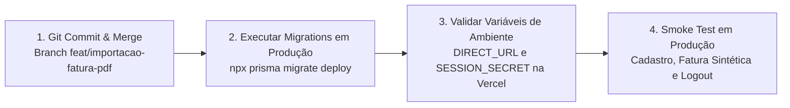
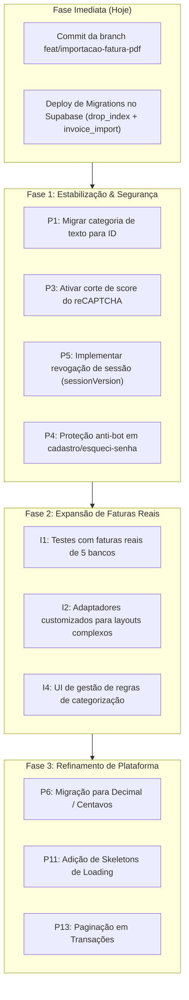

# 06 - Backlog, Pendências e Próximos Passos

#backlog #roadmap #pendencias #debito-tecnico #melhorias

> [!NOTE] Direcionamento Estratégico
> Esta nota consolida as pendências técnicas imediatas que bloqueiam a publicação em produção, o backlog priorizado de débitos e melhorias (P1 a P19 do `docs/MELHORIAS.md`) e o roteiro de evolução da funcionalidade de importação de faturas.

---

## 🚨 1. Ações Imediatas (Bloqueios de Pré-Deploy)

Antes de promover o código da branch `feat/importacao-fatura-pdf` para produção, é mandatório cumprir os três passos a seguir:



### 1.1 Consolidação Git e Merge
A branch de trabalho `feat/importacao-fatura-pdf` contém arquivos modificados e não versionados essenciais:
- Módulo `src/features/invoice-import/` e rotas `/api/imports/` e `/api/category-rules/`.
- Script de cópia do worker do pdf.js `scripts/copy-pdf-worker.mjs`.
- Migrations de banco e suíte de testes E2E (`tests/e2e/11-invoice-import.spec.ts`).

### 1.2 Migrations Pendentes no Banco de Produção (Supabase)
O deploy da Vercel executa apenas `next build` e **não** roda migrations de banco de dados por padrão. As duas migrations abaixo **precisam ser aplicadas manualmente** via terminal:
```bash
npx prisma migrate deploy
```
1. **`20261012000000_drop_legacy_budget_index`:**
   - Remove o índice único global `budgets_category_month_key` que causava colisão entre usuários diferentes tentando criar orçamentos com mesmo nome e mês.
2. **`20261013000000_add_invoice_import`:**
   - Cria as tabelas `import_batches`, `import_batch_items` e `category_rules`.
   - *Nota:* Esta migration não altera a tabela `transactions`; portanto, mesmo antes de sua aplicação, o restante do sistema permanece funcionando.

---

## 📋 2. Backlog Priorizado de Melhorias (P1 a P19)

### 🔴 Alta Prioridade (Arquitetura e Segurança Crítica)

| # | Item | Causa Raiz & Impacto | Ação Recomendada |
|---|---|---|---|
| **P1** | **Categoria referenciada por nome textual** em transações e orçamentos | Renomear uma categoria zera suas métricas nos cards e quebra o vínculo com orçamentos. Excluir uma categoria deixa transações órfãs com texto estático. | **Solução Definitiva:** Migrar para `categoryId` (chave estrangeira com integridade referencial).<br/>**Paliativo Imediato:** Ao renomear, atualizar `Transaction` e `Budget` na mesma transação atômica (`$transaction`) e bloquear exclusão de categorias que possuam transações vinculadas. |
| **P2** | **Limite de tentativas de login em memória** | O contador atual de 5 tentativas por 15 min reside na memória do processo Node.js. Na infraestrutura serverless da Vercel, cold starts frequentes zeram o contador e requisições caem em instâncias separadas. | Migrar o rate limiting para armazenamento compartilhado distribuído (ex.: Upstash Redis ou tabela dedicada no PostgreSQL). |
| **P3** | **Corte por score do reCAPTCHA desativado** | O código atual valida a comunicação com o Google, mas a linha que verifica o limiar de pontuação (`score >= 0.5`) está comentada. Bots com score baixo passam livremente. | Descomentar a validação, definir limiar de corte inicial em 0.5 e monitorar métricas de rejeição. |
| **P4** | **Cadastro e "Esqueci a Senha" desprotegidos** | As rotas `/api/register` e `/api/auth/forgot-password` não exigem reCAPTCHA nem possuem limitador de taxa, permitindo disparo em massa de e-mails para terceiros e criação automatizada de contas. | Estender a validação do token reCAPTCHA v3 e o rate limiting para ambos os endpoints. |
| **P5** | **Sessões stateless sem mecanismo de revogação** | O token de sessão de 30 dias é assinado criptograficamente, mas não consulta estado de revogação. Ao fazer logout ou trocar a senha, sessões abertas em outros computadores permanecem válidas até os 30 dias expirarem. | Adicionar um campo `sessionVersion: Int` no modelo `User`. O valor é embutido no cookie e conferido em `getAuthenticatedUser`. Alterar a versão invalida instantaneamente todas as sessões ativas. |

---

### 🟡 Média Prioridade (Confiabilidade e Experiência do Usuário)

| # | Item | Problema Atual | Solução Proposta |
|---|---|---|---|
| **P6** | **Valores monetários em `Float`** | O tipo `Float` no PostgreSQL e JavaScript causa erros de imprecisão de ponto flutuante acumulados em somas financeiras extensas. | Migrar os campos `amount` para `Decimal(12,2)` no Prisma ou representação inteira em centavos. |
| **P7** | **Regra contábil de Investimentos vs Saldo** | O cálculo de saldo desconta investimentos da conta corrente, mas certos textos de UI dizem "saldo de receitas e despesas", confundindo o usuário. | Harmonizar textos informativos da interface explicando que o saldo exibido é o *saldo livre em conta corrente*. |
| **P8** | **Sinal contábil não validado contra o Tipo na API** | O backend aceita que uma transação de tipo `income` receba valor negativo via requisição direta. | Incluir validação no schema da API exigindo que `income` possua $amount > 0$ e `outcome`/`investment` possuam $amount < 0$. |
| **P9** | **Cards superiores do Dashboard acumulam todo o histórico** | Os 4 cards do topo exibem dados acumulados de todos os tempos, posicionados ao lado do "Resumo do Mês", sem sinalização visual clara de período. | Adicionar rótulo explícito "Histórico Total" ou alternador para visualização exclusiva do mês em foco. |
| **P10** | **Sessão expirada exibe telas vazias** | Quando o cookie de 30 dias expira com o app aberto, requisições retornam `401` e os serviços interpretam como lista vazia (`[]`), dando a impressão de perda de dados. | Interceptar respostas `401` na camada HTTP (`src/services/http.ts`) e redirecionar automaticamente para `/login` com toast explicativo. |
| **P11** | **Falta de indicadores de carregamento (Skeletons)** | Durante a busca inicial de dados, a interface exibe rapidamente valores em R$ 0,00 e textos de "nenhum registro encontrado" antes de popular os dados reais. | Implementar flag `loading` nos contextos e componentes de esqueleto visual (loading skeletons). |
| **P12** | **Tokens de recuperação de senha em texto puro** | Tokens de reset são armazenados em texto legível no banco de dados. Caso o banco vaze, links ativos tornam-se utilizáveis. | Gravar o hash SHA-256 do token e validar o consumo com `updateMany` condicional em `usedAt: null`. |
| **P13** | **Endpoint `GET /api/transactions` sem paginação** | A rota atual devolve todos os registros do usuário de uma só vez, o que degradará a performance após milhares de lançamentos. | Implementar paginação com suporte a cursor e filtros opcionais de data na própria query do Prisma. |
| **P14** | **Proteção de rotas do proxy restrita a caminhos exatos** | O `src/proxy.ts` valida igualdade estrita (`pathname === rota`). Se uma subrota como `/transactions/[id]` for criada, ela escapará do guarda. | Ajustar a regra de matching para verificação por prefixo (`startsWith`). |
| **P15** | **Rótulos dos gráficos de saldo mensal** | Os gráficos "Evolução do Saldo" plotam o superávit/déficit isolado de cada mês, e não a curva acumulada de patrimônio. | Renomear os eixos e títulos para "Resultado Mensal (Líquido)". |
| **P16** | **Acessibilidade em Modais e Drawer Mobile** | O foco do teclado (Tab) não fica confinado dentro dos modais abertos, e o menu drawer mobile não se fecha ao pressionar a tecla `Esc`. | Implementar focus trap acessível e captura de tecla `Esc` no drawer móvel. |
| **P17** | **Tratamento de falhas de carregamento** | Falhas de rede em `fetchTransactions` caem no console e deixam a tela em branco, sem alertar o usuário de que houve erro de conexão. | Adicionar estado visual de erro com botão "Tentar novamente". |
| **P18** | **Módulo de Metas: Progresso e Metas Concluídas** | Se o usuário atinge R$ 1.200 de uma meta de R$ 1.000, o card exibe "120%" enquanto a barra para em 100%. Falta status explícito de meta concluída. | Limitar a barra em 100%, adicionar badge de "Concluída" e separar metas ativas das já finalizadas. |
| **P19** | **Busca de transações sensível a acentos** | Digitar "salario" não localiza uma transação salva como "Salário". A busca também não varre anotações ou nomes de categoria. | Normalizar acentos na busca (`normalize("NFD")`) e estender a busca para a coluna de categoria e notas. |

---

### 🟢 Baixa Prioridade & Débitos Técnicos Menores

- **Limpeza de Memória no Logout:** A transição do logout utiliza navegação cliente, mantendo o estado do React Context carregado na memória do browser até novo refresh.
- **Convivência de Gerenciadores de Pacote:** Existem `package-lock.json` e `yarn.lock` simultaneamente na raiz do repositório; padronizar em um único gerenciador.
- **Limpeza de Componentes Órfãos:** Remover componentes não utilizados deixados por versões anteriores (`src/components/Dashboard`, `Header`, `TransactionTable`).
- **Otimização de Custo do Bcrypt:** O `bcryptjs` em JavaScript puro consome entre 700 e 900 ms de processamento síncrono do Event Loop por login. Avaliar transição para biblioteca nativa compilada ou `argon2`.

---

## 📑 3. Pendências Específicas da Importação de Fatura (I1 a I7)

Embora o MVP da importação via PDF esteja funcional e coberto por testes com PDFs sintéticos, a esteira de refino contempla:

| Código | Item | Complexidade | Descrição e Próximo Passo |
|---|---|---|---|
| **I1** | **Testes com Faturas Reais de Bancos** | Média | Coletar faturas reais anonimizadas dos principais emissores brasileiros (Nubank, Itaú, Bradesco, Santander, Inter, C6) e auditar se o parser genérico extrai 100% dos lançamentos. |
| **I2** | **Adaptadores Especializados por Emissor** | Média | Faturas que exibem duas colunas de data (data da compra e data de lançamento) ou que imprimem "parcelas futuras" demandam adaptadores dedicados (`src/features/invoice-import/extract/adapters/`). |
| **I3** | **Criação de Categoria Inline no Preview** | Baixa | Permitir que o usuário crie uma nova categoria diretamente de dentro da tabela de preview caso nenhuma das existentes atenda ao estabelecimento lido. |
| **I4** | **Tela de Gestão de Regras de Categorização** | Baixa | A API `/api/category-rules` já está implementada; resta criar uma interface visual dentro de `/settings` para listar e excluir regras aprendidas ("Lembrar para as próximas faturas"). |
| **I5** | **Rate Limiting em `/api/imports`** | Baixa | Limitar a importação a no máximo 10 lotes por hora por usuário para prevenir abusos de armazenamento e processamento. |
| **I6** | **Grid Responsivo em Cartões para Mobile** | Média | A tabela do preview no celular atualmente demanda rolagem horizontal; transformá-la em cartões verticais idênticos aos de `TransactionList`. |
| **I7** | **Automação de Migrations no Build** | Baixa | Alterar o script de build para `"build": "prisma migrate deploy && next build"` assim que `DIRECT_URL` for cadastrada na Vercel. |

---

## 🗺️ 4. Roadmap Visual de Evolução



---
*Próxima leitura recomendada: [[07 - Qualidade e Suíte de Testes]] para entender a infraestrutura de confiabilidade que suporta este backlog.*
